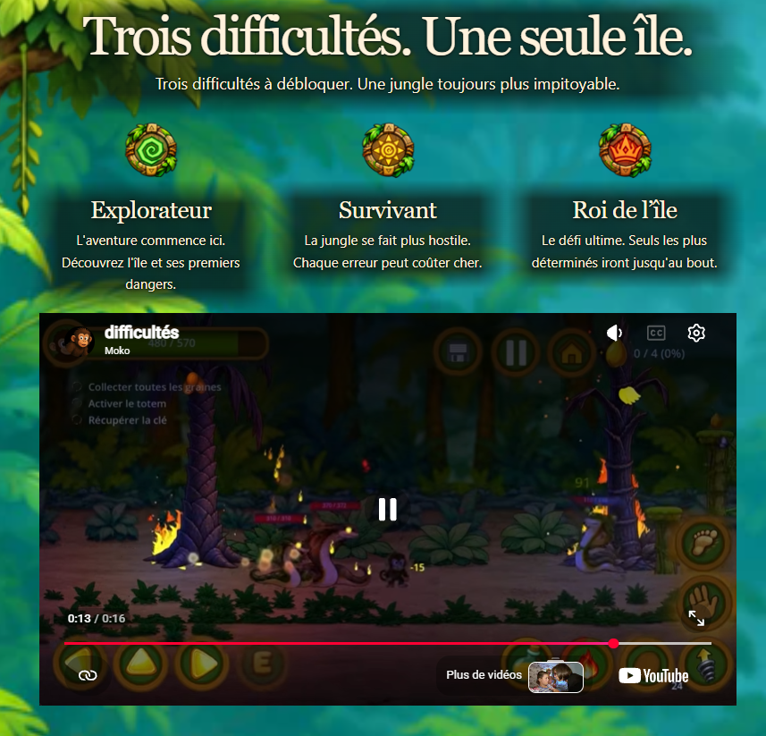
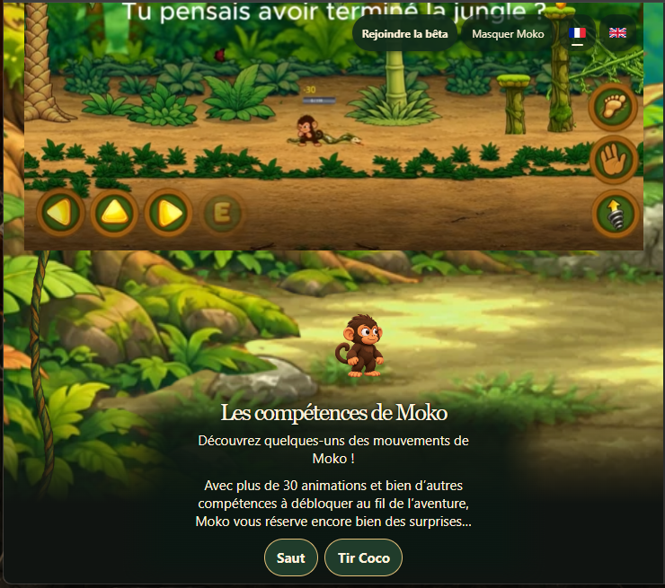

### A Mysterious Island. An Evolving Jungle. Moko Faces the Unknown.

**Official website of Island Evolution**, a 2D action-adventure platformer.

**[Explore the Official Website](https://steph4477.github.io/IslandEvolution-Website/)**

## Discover Moko's World

Explore a living jungle, discover Moko's abilities, and take on three progressively unlockable difficulty levels. Enemies evolve based on your performance, and the adventure can continue beyond the final difficulty.

The website offers an immersive introduction to the game's world, gameplay footage, and interactive experiences with Moko. It will also host registration for the Android beta on Google Play (**20 spots planned**).

## Website Preview

**Welcome – Enter the Jungle**

**Difficulty Levels – One Island, Three Challenges**

**Abilities – Discover Moko in Action**

## Technologies

**SvelteKit · TypeScript · CSS · GitHub Pages**

## Documentation de maintenance

- [Architecture du site](docs/ARCHITECTURE.md)
- [Guide de maintenance](docs/GUIDE_MAINTENANCE.md)
- [Dépannage](docs/DEPANNAGE.md)
- [Déploiement GitHub Pages](docs/DEPLOIEMENT.md)
- [Formulaire bêta](docs/FORMULAIRE_BETA.md)
- [Audit V1.7](docs/AUDIT_V17.md)

---

**[Visit Island Evolution](https://steph4477.github.io/IslandEvolution-Website/)**

