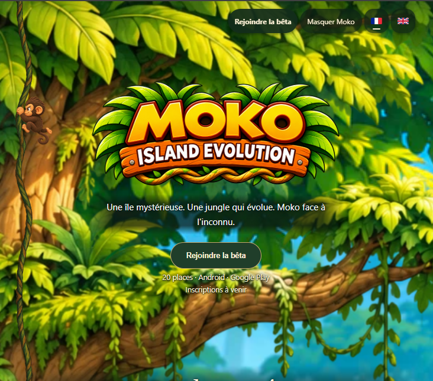

### Une île mystérieuse. Une jungle qui évolue. Moko face à l’inconnu.

**Site officiel d’Island Evolution**, un jeu d’action, d’aventure et de plateformes.

**[Découvrir le site officiel](https://steph4477.github.io/IslandEvolution-Website/)**

## Découvrez l’univers de Moko

Explorez une jungle vivante, découvrez les capacités de Moko et affrontez trois niveaux de difficulté à débloquer. Les ennemis évoluent selon vos performances et l’aventure peut se prolonger au-delà de la dernière difficulté.

Le site propose une immersion dans l’univers du jeu, des extraits de gameplay et des interactions avec Moko. Il accueillera également les inscriptions à la bêta Android sur Google Play (**20 places prévues**).

## Aperçu du site

**Accueil - Entrez dans la jungle**

**Difficultés - Une seule île, trois défis**

**Compétences - Découvrez Moko en action**

## Technologies

**SvelteKit · TypeScript · SCSS · GitHub Pages**

---

**[Visiter Island Evolution](https://steph4477.github.io/IslandEvolution-Website/)**

